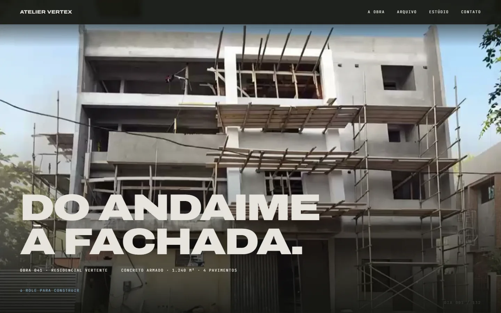
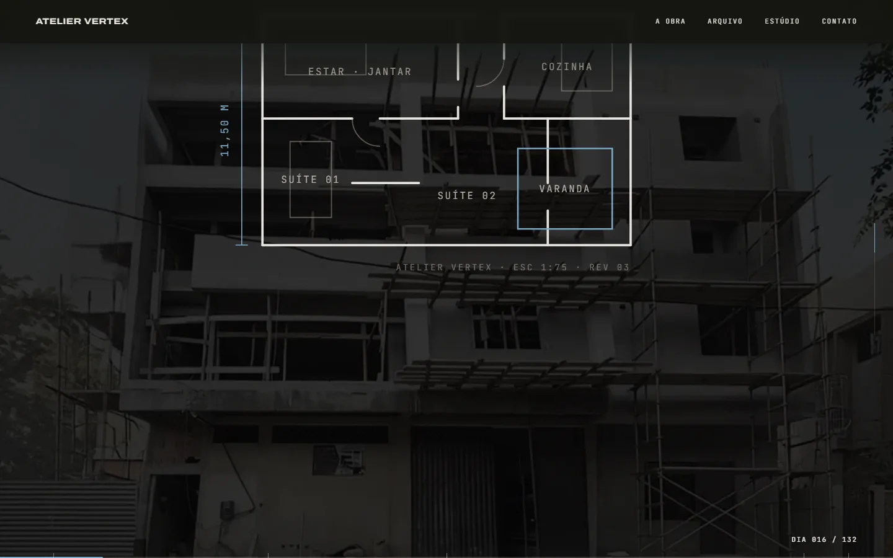
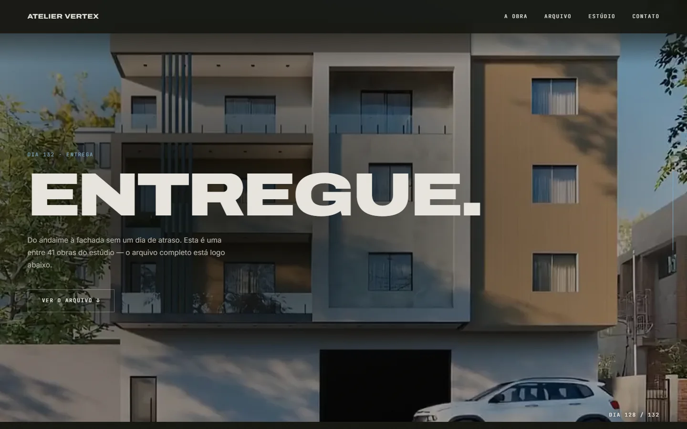

[English](README.md)

# ATELIER VERTEX — v2

Landing page para um escritório de arquitetura **fictício** de alto padrão,
feita como peça de portfólio da **MilWeb**. O ativo central é um vídeo de 5 s
em que uma obra evolui de estrutura crua até o prédio acabado — e **o scroll é
o botão de play**: o vídeo fica fixo em tela cheia atrás da página e o seu
`currentTime` acompanha a cena em que o visitante está.

> **Tipo:** demo comercial (marca fictícia; nomes, números, obras e contatos
> são ilustrativos) · **Demo:** https://atelier-vertex-v2.vercel.app



| Prancha (planta se desenha sobre o vídeo) | Entrega (frame final) |
| --- | --- |
|  |  |

## Funcionalidades

- Vídeo fixo em tela cheia controlado pelo scroll (`VideoRig`): cada seção
  dirige um trecho do vídeo (`lib/scenes.ts`) e um loop `requestAnimationFrame`
  persegue o tempo-alvo com amortecimento.
- Roteiro de cenas: hero, prancha (planta do pavimento desenhada com o scroll),
  três atos do filme, números, final; depois o vídeo esmaece e o "Ato 2" rola
  por cima (arquivo de obras, estúdio, processo, contato).
- HUD de obra (`dia 001 / 132`), linha de cota com marcos e trilho de progresso
  do filme.
- Loader com opção de pular a introdução, navegação com menu hambúrguer no
  mobile e cursor customizado em dispositivos com ponteiro fino.
- Vídeo HD (`hero-hd.mp4`) em telas > 1100 px e versão leve (`hero.mp4`) nas
  demais, com `preload="metadata"` e poster.
- `prefers-reduced-motion`: sem scrub do vídeo, sem Lenis e sem animações de
  entrada.

## Stack

- Next.js 16 (App Router) + React 19 + TypeScript
- Tailwind CSS v4 (apenas tokens no `@theme`; estilo dos componentes em CSS Modules)
- GSAP 3 (ScrollTrigger, SplitText) + Lenis
- `next/font` (Archivo, Inter, JetBrains Mono)
- ESLint (`eslint-config-next`)

## Como rodar

Pré-requisitos: Node.js 20.9+ (CI usa Node 22) e npm.

```bash
npm ci
npm run dev        # http://localhost:3000
```

A performance real do scrub só aparece no build de produção — o modo dev tem
overhead:

```bash
npm run build
npm start
```

O projeto não usa variáveis de ambiente.

### Scripts

| Script | O que faz |
| --- | --- |
| `npm run dev` | servidor de desenvolvimento |
| `npm run build` | build de produção |
| `npm start` | serve o build de produção |
| `npm run lint` | ESLint |

## Estrutura

```
app/                 layout, página única e estilos globais
components/
  VideoRig/          vídeo fixo + HUD de dias + linha de cota
  SceneTracker/      detecta a cena atual e o progresso dentro dela
  sections/          Hero, Prancha, Film, Stats, Finale, Obras, Estudio, Processo, Cta, Footer
  Loader/ Nav/ Cursor/ FilmProgress/ ui/
hooks/useLenis.ts    scroll suave sincronizado ao ticker do GSAP
lib/                 world (estado compartilhado), scenes (roteiro), obras (portfólio), gsap
public/video/        hero.mp4, hero-hd.mp4, poster.jpg
docs/screenshots/    capturas usadas neste README
```

## O vídeo

O arquivo bruto precisa de reencode antes de ir para `public/video/`:

```bash
ffmpeg -i bruto.mp4 -an \
  -vf "minterpolate=fps=48:mi_mode=mci,crop=iw:floor(ih*0.92/2)*2:0:0" \
  -c:v libx264 -crf 20 -pix_fmt yuv420p \
  -g 1 -keyint_min 1 -sc_threshold 0 \
  -movflags +faststart \
  public/video/hero.mp4
```

- `-an` remove o áudio
- `minterpolate` dobra 24→48 fps (a 24 fps o scrub fica picotado)
- `crop` remove a faixa inferior do clipe original (onde havia marca d'água),
  arredondando para dimensão par (exigência do yuv420p)
- **`-g 1` é o mais importante:** GOP 1 faz todo frame virar keyframe; sem isso
  o seek do scrub engasga
- `+faststart` move o índice do MP4 para o começo do arquivo

Poster (primeiro frame, evita flash preto):

```bash
ffmpeg -i public/video/hero.mp4 -vframes 1 -q:v 3 public/video/poster.jpg
```

## Limitações

- Conteúdo fictício: escritório, obras, números (41 obras, 132 dias etc.),
  WhatsApp (`5511000000000`) e e-mail (`ateliervertex.example`) são
  ilustrativos e não funcionam como contato real.
- As fotos do arquivo de obras são carregadas do Unsplash em tempo de execução
  (`images.unsplash.com`); sem acesso à rede elas não aparecem.
- Os vídeos somam ~18 MB no repositório; o scrub depende de GOP 1, então
  vídeos reencodados sem `-g 1` vão travar.
- Sem testes automatizados; a CI roda lint, typecheck e build.

## Créditos e mídias

- Vídeos em `public/video/` (`hero.mp4`, `hero-hd.mp4`, `poster.jpg`): origem
  não documentada.
- Fotos do arquivo de obras: Unsplash (IDs em `lib/obras.ts`), sujeitas à
  licença do Unsplash.
- Design e desenvolvimento: MilWeb.

## Segurança

Veja [SECURITY.md](SECURITY.md) para reportar vulnerabilidades.

## Licença

Ainda não há licença definida; todos os direitos reservados ao autor.
